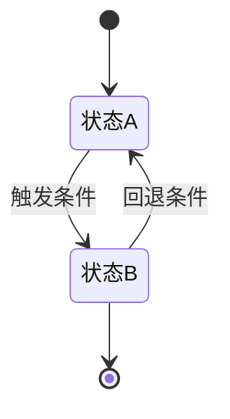
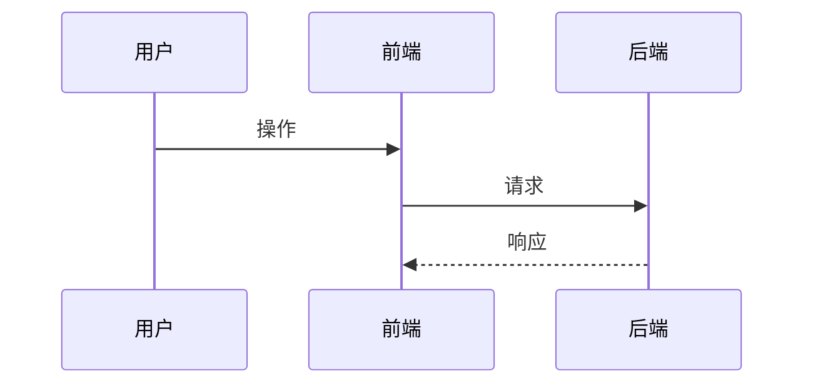

# [Vectoree] - 需求文档 - [需求名称]

> **怎么读这份文档。** 本文与一份已交付的 HTML 前端配套：前端由产品侧改完并交付源码，研发按本文补齐后端、数据库与埋点实现。
>
> **边界约定**：HTML 里能看到的（布局、样式、文案、静态交互、前端状态切换）以 HTML 源码为准，本文不复述；HTML 里看不到或只是 mock 的（接口、数据落库、服务端判定、权限、限流、异步任务、第三方回调）以本文为准。**两者冲突时先停下确认，不要自行裁决。**
>
> **每条规则只在一个地方定义**，其他位置只引用章节号、不复述。

---

## 0 文档信息

### 0.1 变更记录

> 只记**交付定稿之后**的改动；定稿前的修订不列入，需要考古时查 git。

| 日期 | 变更摘要 |
| - | - |
| | |

### 0.2 交付物清单

> 研发接手的全部输入。缺任何一项都要在评审时提出，不要默认"应该有"。

| 类型 | 内容 | 位置 |
| - | - | - |
| 前端 HTML | [文件名 / 目录] | [绝对路径或仓库路径] |
| 参考截图 | [如有] | [路径] |
| 本需求文档 | 本文 | [路径] |
| 前置方案 / 规则定稿 | [文档名] | [链接] |

### 0.3 前端交付说明

| 项 | 内容 |
| - | - |
| 交付形态 | [单文件 HTML / 仓库分支 + 路径] |
| 如何查看 | [本地启动命令 + 路由，或直接双击打开] |
| 需登录态查看的页面 | [是/否；如是，说明 mock 登录方式] |
| **HTML 中的 mock 面** | [哪些数据是假的：登录、接口调用、localStorage key、mock 事件、演示数据常量，逐项列] |
| **HTML 不可信的部分** | [demo 面板 / mock 登录 / 演示态 / 调试入口——明确禁止照抄进生产] |

> **mock 面这一行是本文最容易漏、也最容易出事的部分。** HTML 里的假数据如果被研发当成真实设计照抄进生产，会同时产生数据污染和逻辑错误。逐项列出，不确定就写"待确认"，不要留空。

### 0.4 发布计划

- **计划发布时间**：[如 M12-Week2（YYYY.MM.DD）]
- **是否需灰度 / 回滚预案**：[是（写明）/ 否]

### 0.5 关联文档

| 文档 | 关系 |
| - | - |
| [前置方案 / 规则定稿] | [规则来源，本文与其对齐] |
| [现网服务 / 表] | [生产权威口径，本文与其对齐的点] |

---

## 1 需求背景与目标

### 1.1 要解决的问题

[为什么现在做：业务上下文、用户当下卡在哪、这个需求解决什么。写清"不做会怎样"。]

### 1.2 本期范围

**做：**

| 类型 | 模块 |
| - | - |
| 新做 | [模块] |
| 改现有模块 | [模块] |
| 必须删的现网逻辑 | [具体到现网哪个函数 / 页面 / 路由] |

**不做（明确排除）：**

| 项 | 说明 |
| - | - |
| | |

> "不做"这一栏和"做"同等重要。研发最容易在"顺手优化一下"时越界，本表是验收时会逐条核对的项。

### 1.3 成功度量

[用什么指标判断这个需求做成了。埋点口径见 §7。]

---

## 2 需求概述

> 一段话说清：这次要做什么、做完之后用户能干什么、跟现在有什么不同。评审时看这一段就能建立整体认知。

[3–5 句话概述。避免罗列细节，细节在 §5。]

**核心功能点一览：**

| # | 功能点 | 一句话说明 | 涉及页面 | 优先级 |
| - | - | - | - | - |
| 1 | | | §5.x | P0 |

---

## 3 需求涉及范围

> **本文的定位章节。** 前端已交付，研发需要这份清单知道自己要动哪些地方、哪些不要动。路径以实际仓库为准，研发按此逐条替换即可完成对接。

### 3.1 涉及页面 / 模块总览

| # | 路径 | 页面 / 模块 | 改动性质 | 前端是否已交付 | 研发需完成 |
| - | - | - | - | - | - |
| 1 | `/dashboard/xxx` | Xxx 页面 - 某模块 | 新增 / 修改 / 删除 | 是 | 接口 + 数据落库 |
| 2 | | | | | |

### 3.2 需删除的现网逻辑

> 单列一节。删错会引发回归，漏删会造成双入口 / 旧逻辑抢占，最容易出事。

| # | 位置（文件 / 函数 / 路由） | 现状行为 | 本期处理 | 不删的后果 |
| - | - | - | - | - |
| 1 | | | 必须删除 / 保留但改条件 | |

### 3.3 明确不动的部分

| 位置 | 为什么不碰 |
| - | - |
| | |

### 3.4 影响面

| 类型 | 影响 | 说明 |
| - | - | - |
| 现网其他页面 | [是否被牵连] | |
| 现网服务 | [被改动 / 仅新增] | |
| 现网数据表 | [新增表 / 改字段 / 只读] | |
| 异步任务 / 定时任务 | | |
| 第三方 / 外部回调 | | |

---

## 4 流程与逻辑

> ASCII 树给整体判断逻辑（到处都能看、不依赖渲染）；Mermaid 补状态机与时序（这两种关系用文字说不清）。**不是每篇都要图：说不清才画，不凑数。**

### 4.1 主流程（ASCII 分支树）

```
[触发入口]
  ↓
[判断 1]
  ├─ 分支 A → [结果 A]
  │             ↓
  │          [后续判断 / 结束态]
  └─ 分支 B → [结果 B]
                ↓
             [兜底 / 异常分支]
```

### 4.2 状态机（Mermaid）



**状态定义表：**

| 状态 | 含义 | 进入条件 | 停留多久 | 可能的下一状态 |
| - | - | - | - | - |
| | | | | |

> 状态机是后端建模的依据。凡是前端 HTML 里**能出现多个不同形态**的地方（loading / 空态 / 错误态 / 多种成功态），就应该是一个明确的状态，写进这张表。**前端把三种不同情况合并成一种视觉呈现时（常见于 demo），必须在本文拆开分别定义**——否则研发会以为只有一种。

### 4.3 关键时序（Mermaid，可选）



### 4.4 判断逻辑与分支条件

| # | 判断点 | 判定条件 | 条件成立 | 条件不成立 |
| - | - | - | - | - |
| 1 | | | | |

> **写「可判定粒度」**：条件要落到能直接翻译成代码的判断表达式（读哪个字段、比什么值、时间窗口怎么算），不要写"符合条件的用户"这种需要研发再猜一次的表述。

### 4.5 异常与边界

| # | 场景 | 触发条件 | 系统行为 | 用户可见表现 | 数据是否落库 |
| - | - | - | - | - | - |
| 1 | 并发 / 重复触发 | | 幂等 / 拒绝 | | |
| 2 | 超时 | | | | |
| 3 | 依赖服务失败 | | 降级 / 报错 | | |
| 4 | 权限不足 | | | | |
| 5 | 数据缺失 / 脏数据 | | 兜底 | | |

> 这张表是**研发不回来追问的最后保障**。每一条都要能回答：谁触发、系统怎么办、用户看到什么、数据留不留痕。留痕与否直接影响后续排查和对账，不能只写"报错"。

---

## 5 需求说明（分页面详讲）

> **本文主体。** 逐个页面讲清：改哪条路径、这个页面在做什么、有哪些模块、每个模块的规则与边界是什么。
>
> 每个页面统一五段：**路径定位 → 页面职责 → 模块拆解 → 状态与边界 → 研发交付要点**。

### 5.x [页面名称]

#### 5.x.1 路径定位

| 项 | 内容 |
| - | - |
| 路由 | `/xxx/yyy` |
| 前端文件 | [HTML 中的相对路径或分支路径] |
| 入口来源 | [从哪进：导航栏 / 弹窗 / 跳转链接 / 深链] |
| 离开方式 | |
| 需登录 | 是 / 否（未登录时的行为） |

#### 5.x.2 页面职责

[这个页面存在的意义，一句话。]

#### 5.x.3 模块拆解

| # | 模块 | 位置（HTML 标注 ①②③） | 功能 | 关键交互 | 优先级 |
| - | - | - | - | - | - |
| 1 | | ① | | | |

> 标注方式：在 HTML 交付说明里给出截图或在源码里加 ①②③ 标记，文档与 HTML 一一对应。**不要在文档里用"左上角按钮"这种相对位置描述**——HTML 一改就失效。

#### 5.x.4 各模块规则详述

**① [模块名]**

- **展示规则**：什么条件下显示 / 隐藏、显示什么内容
- **数据来源**：字段名、类型、示例值（前端拿不到真实数据时，这里给到字段级）
- **交互逻辑**：点击 / 悬停 / 输入分别发生什么
- **边界**：
  - 加载中：skeleton / spinner / 骨架屏
  - 空态：无数据时的文案与引导按钮
  - 错误态：失败文案 + 是否可重试
  - 无权限：看到什么
- **用户可见文案**（逐字，研发直接用）：
  | 场景 | 文案 |
  | - | - |
  | | |

**② [模块名]**（同上结构）

#### 5.x.5 状态与边界

| # | 状态 | 判定条件 | 界面表现 | 可否重试 / 下一步 |
| - | - | - | - | - |
| 1 | 初始 / 加载 / 空 / 失败 / 成功 | | | |

> **凡是 HTML 里存在多种形态的地方都要列全。** 前端 demo 常把多种情况收敛成一种视觉表现（例如把"失败但不发奖""成功但条件不满足"合并成一个静默成功态），研发照抄就会丢业务分支——必须在本文拆开。

#### 5.x.6 研发交付要点

| # | 要做什么 | 依赖 | 验收标准 |
| - | - | - | - |
| 1 | [接口 / 数据落库 / 服务端校验 / 权限 / 埋点] | | [怎么算做完] |

---

## 6 数据与接口约定

> **本文只写业务规则与数据语义，不规定 REST 路径与 DDL**——那是研发的决策范围。但业务语义必须写到"研发不需要再问一次产品"的程度。

### 6.1 数据实体与字段语义

| 实体 | 字段（业务名） | 业务含义 | 取值范围 / 枚举 | 谁产生 | 谁消费 |
| - | - | - | - | - | - |
| | | | | 前端 / 服务端 / 用户 | |

> 枚举值必须列全并逐个说明含义。**"状态"类字段尤其要列全**——前端 HTML 里的每个视觉状态都对应一个枚举值，漏一个研发就不知道怎么返回。

### 6.2 接口清单（业务语义层）

| # | 接口用途 | 触发时机 | 调用方 | 关键入参 | 关键出参 | 幂等要求 | 失败语义 |
| - | - | - | - | - | - | - | - |
| 1 | | | | | | 必须 / 可 | |

> **幂等要求**：涉及发钱、发放额度、发券、建关系的接口，幂等要求必须写明"重复调用返回什么"。不写研发默认按最简实现，线上会出现重复发放。

### 6.3 服务端校验与权限

| # | 校验点 | 规则 | 不通过时的结果 | 用户可见表现 |
| - | - | - | - | - |
| 1 | | | 拒绝 / 降级通过 | |

> **前端已实现的校验，服务端必须再实现一遍。** 前端校验是体验，服务端校验才是安全。逐条列出哪些校验需要双写。

### 6.4 时序相关约定

| # | 场景 | 时限 | 超时处理 | 用户感知 |
| - | - | - | - | - |
| 1 | 校验 / 探测 / 发放 | [如最长 10s] | [按失败处理 / 保留进度] | |

### 6.5 数据留存与生命周期

| 数据 | 保留时长 | 到期处理 | 依据 |
| - | - | - | - |
| | | | [业务口径 / 财务要求] |

---

## 7 数据埋点

> 目的：验证 §1.3 的成功度量，并能定位链路在哪一步流失。**埋点口径与 §1.3 必须一致，不在这里另立标准。**

### 7.1 埋点目标

[要回答哪几个问题：转化率？在哪一步流失？各入口贡献多少？]

### 7.2 公共参数

| 参数 | 说明 | 取值 |
| - | - | - |
| `user_id` | | |
| `org_id` | | |
| [业务参数] | | |

### 7.3 页面 / 模块曝光埋点

| # | 事件名 | 触发时机 | 页面 / 模块 | 关键参数 | 关联度量 |
| - | - | - | - | - | - |
| 1 | | 元素进入视口 / 页面加载完成 | §5.x ① | | §1.3 指标 1 |

### 7.4 关键按钮 / 操作埋点

| # | 事件名 | 触发时机 | 按钮 / 操作 | 关键参数 | 期望去向 |
| - | - | - | - | - | - |
| 1 | | 点击（成功 / 失败分别打） | §5.x ① 复制按钮 | [是否复制成功] | 下一环节 |

> **成功与失败要分别打点**，参数里带 `result` / `error_code`。只打点击不区分结果，线上出问题无法定位是接口挂了还是用户直接走了。

### 7.5 链路追踪

> 从入口到终点的完整序列，按顺序编号，与 §4.1 主流程一一对应。

| 步骤 | 环节 | 对应事件 | 上报时机 | 关键参数 | 流失定义 |
| - | - | - | - | - | - |
| 1 | 进入页面 | | | | |
| 2 | | | | | |

### 7.6 埋点验收

| # | 验收项 | 方式 |
| - | - | - |
| 1 | 事件按预期上报 | [调试模式查看上报 / 校验平台入库] |
| 2 | 关键路径参数完整 | |
| 3 | 无重复上报 | [刷新 / 重复点击场景] |

---

## 8 待确认项

| # | 项 | 责任人 | 待决策 | 截止 |
| - | - | - | - | - |
| 1 | | | | |

---

## 可选补充模块（按需取用，不打乱主线）

> 主干 §1–§8 走完即完整。以下按需求规模选用，不需要的直接整节删除，不要留空壳。

### A. 验收标准

[端到端验收场景清单：正常路径 / 每个异常分支 / 每个边界，每条写清操作步骤与预期结果。]

### B. 非功能要求

| 维度 | 要求 | 说明 |
| - | - | - |
| 性能 | | [首屏 / 接口 P95 / 批量处理耗时] |
| 并发 | | [是否有限流、幂等键设计] |
| 兼容 | | [浏览器 / 端 / 版本] |
| 安全 | | [敏感数据、越权、频控] |
| 可观测 | | [日志、告警、错误上报] |

### C. 灰度与回滚

[灰度维度（用户 / 组织 / 流量比例）、开关设计、回滚操作与回滚后表现。]

### D. 需求前后对照（Change Log 式说明）

| 场景 | 现状 | 本期之后 | 研发注意 |
| - | - | - | - |
| | | | [易踩坑处] |
