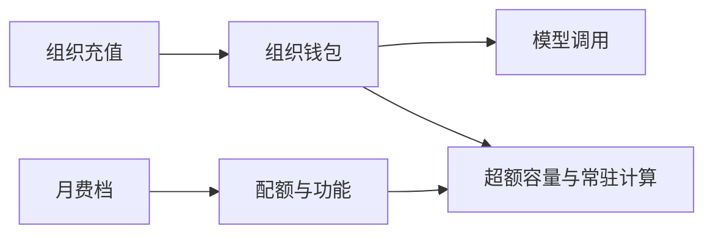

# Vectoree - 调研报告 - 订阅收费方案

> **怎么读。** 本文只定 Vectoree 自己向开发者组织收钱的逻辑：现在继续按量，以后月费买配额和功能，用量仍从组织钱包扣。
>
> **以现网为准。** 2026-08-14 产品洞察里的 Free / $49 席位 / $499 是含终用户分润和交易市场的远期推演，不当作现在能卖的价目。
>
> 本文不改产品代码、不改官网文案、不写接口。数字凡标「建议」的，都是拍板前的锚点。

---

## 0 文档信息

| 项 | 内容 |
| - | - |
| 日期 | 2026-10-20 |
| 状态 | DRAFT，待拍板第 6 节三件事 |
| 选定模型 | 配额订阅 + 用量钱包，分三期打开 |

### 0.1 关联

| 文档 | 关系 |
| - | - |
| [launch-checklist.md](../../launch-checklist.md) 第 7 节 | 现网计费事实与「订阅卖功能、PAYG 卖烧云」口径 |
| [Product_Docs_Plan.md](../03_Solutions/Product_Docs_Plan.md) | 文档站口径：无月费，Auth / DB / Storage 暂无独立计量 |
| [Deploy 功能调研](./Deploy_Feature_Research.md) 第 5.6 节 | 部署收费的前置约束 |
| [产品洞察 v1.0](../../01_Product/Product_Insights_%26_Roadmap_v1.0_20260814.md) Part 5 | 远期参照，不覆盖现网 |
| `02_Knowledge/00_Competitive/*/Pricing.md`、[竞品矩阵](../../02_Knowledge/00_Competitive/Competitor_Matrix.md)、[Monid 分析](../../02_Knowledge/00_Competitive/Monid_Competitor_Analysis.md) | 竞品计费事实，核实日期见各档案 |

---

## 1 现网能卖什么、不能卖什么

### 1.1 已经在卖

上线清单和文档站口径一致，用户现在能用的是：

- 模型网关与密钥
- Auth、Database、Storage
- 组织钱包：Stripe 充值，预付余额
- CLI `login` / `link`，以及 db / storage / ai

计费实现是：**无月费。充值进组织钱包，按模型用量扣。** 钱包未激活不能打网关。Auth、Database、Storage 跑在共享基础设施上，账单里还没有独立计量行。

### 1.2 现在不能拿来收月费

Dashboard 侧隐藏、文档站 “What ships now” 排除的能力，都不能出现在价目上：

- Templates、Skills Hub
- Sites / Deploy、Edge Functions、Realtime、Compute
- 自定义域名、预览环境、不休眠承诺

部署未对租户开放，没有可转嫁的机器成本。没有计量器的项目，不加进自动账单。

### 1.3 和远期战略稿的分界

| 收入口袋 | 现网 | 本文 | 2026-08-14 战略稿 |
| - | - | - | - |
| 组织钱包里的模型费 | 已有 | 继续，作为用量主账单 | 模型与基建原价直通 |
| 月费（配额 + 功能） | 无 | 计量就绪后再开一档 | $49/席、$499、企业年单 |
| 终用户交易抽成、代收款、模板市场分成 | 未开 | 不在本文定价 | 第二口袋 |

租户应用里给自己的用户接 Stripe，是租户的收款，不是 Vectoree 的组织钱包充值。那条线继续后置。

---

## 2 竞品计费模型与取舍

竞品档案已有明细。这里只留「收什么、适合什么产品」，不重写四件套。价格为档案记录，拍板前若要对外引用，再对一次官网。

### 2.1 五类结构

**纯 PAYG，无月费。** OpenRouter、Monid。

- OpenRouter：模型原价直通；信用卡充值手续费 5.5%（单笔最低约 $0.80）；余额约 365 天。利润在手续费，不在每条 token 加价。Enterprise 另议。
- Monid：单一预付余额，按调用计费，主页明确不做订阅。新账号约 $1 额度。

适合成本随调用剧烈波动、又没有功能档可卖的网关。Vectoree 的模型账单已经落在这一类。

**月费打包配额，超出按量。** InsForge、Supabase。

- InsForge（直接竞品，2026-08-13 经第三方评测，官方定价页当时未直接抓取）：$0 / Pro $25 / Enterprise。免费档约一周无活动休眠。档案判断其利润在平台订阅和 DB、Storage、Functions 超额，模型通道不是利润核心。
- Supabase：Free $0 / Pro $25（含 $10 Compute Credit）/ Team $599 / Enterprise。计划内含磁盘、MAU、Egress、文件存储；超出按量。每个项目的数据库规格另计，计划费不等于算力费。免费档最多约 2 个项目，约一周无活动暂停。

适合「后端容量 + 流量」有稳定地板、调用量又不可预测的产品。这是 Vectoree 在数据库、存储、以后部署上要长成的结构。

**席位订阅 + 用量附加。** Vercel。

- Hobby $0 / Pro $20 每席 / Enterprise（合同通常从较高月费起）。
- 带宽、构建、函数 CPU、Blob、镜像优化等分开计。Hobby 流量很慷慨；Pro 超出按需扣卡。

部署上线后，成本形态最接近这一类。Vectoree 只借它的计量拆法（构建、运行时、流量分开），不把 30 多个用量维度铺到用户账单上。

**功能档订阅，用量是附加项。** Clerk。

- Hobby $0 / Pro 约 $20–$25 / Business 更高。计费单位在 2026-02 从 MAU 改为 MRU。
- 组织个数、SSO 连接、卫星域名等按个加价。内部档案把这记成「基础月费便宜、刚需能力另加」的钩子。

Vectoree 的月费以后可以卖功能（不休眠、自定义域名、成员、SSO），单价不按连接数、组织数、域名数累加。

**席位打包 + 交易抽成。** 2026-08-14 战略稿里的 Vectoree 自身远期模型（$49/席、交易抽成 0.5%–3%）。前提是装配向导、Stripe Connect 分润和交易市场都已开卖。现网没有这些，本文不启用。

### 2.2 取舍

| 模型 | 对 Vectoree 的判断 |
| - | - |
| 永远纯 PAYG | 盖得住模型，盖不住磁盘、流量和以后的常驻实例。InsForge / Supabase / Vercel 都不用模型加价去养后端。 |
| 立刻改成纯月订、用量包死 | 模型单价跨度极大（OpenRouter 档案约 $0.07 到 $150+ / 百万 token）。月费要么亏在重用户上，要么让轻用户觉得贵。 |
| 现在就卖 $19 / $49 订阅档 | 上线清单已写明：没有对应功能，也没有计量。Landing 上的 Free / Pro / Team 与代码无关，应维持 PAYG 口径。 |
| Clerk 式按个加价 | 排除。组织、SSO、自定义域名进功能档，不按个数抽成长税。 |
| 配额订阅 + 用量钱包 | 采用。月费买配额和功能；真正烧云的调用、磁盘、流量、常驻计算进组织钱包。 |

---

## 3 选定模型与红线

### 3.1 选定

**配额订阅 + 用量钱包，分三期打开。**

现在对外只有组织钱包。月费在「有计量、有可闸门的功能」之后才出现。月费买的是更高配额和功能，模型、超额容量、常驻计算仍从钱包扣。月费不包无限调用。

三期的开关见第 5 节。在开关打开前，价目表不出现那一项。

### 3.2 平台利润怎么留

模型侧只留一个透明口袋，建议采用 **上游原价直通 + 充值手续费**，对齐 OpenRouter：

- 用户在账单里能对上模型单价和钱包扣款。
- 平台费出现在充值这一笔，建议锚点 5.5%（卡充），单笔最低额参考约 $0.80。最终比例见第 6 节。
- 充值手续费和模型 markup 只取一种。两层叠在一起，用户无法核对「我付的 token 价是不是上游价」。

Auth、数据库、存储、部署的平台毛利，放在月费包含的配额差，以及超出后的单价里。这些单价单独列行，不摊进 token 价。

### 3.3 三条红线

1. **模型与已计量的基建费用对得上明细。** 钱包流水能看到模型、计量单位和金额。视频类按秒，不按百万 token（2026-08-25 模型上架会议已纠正阿里 wan 的计量单位）。
2. **平台费只有一个模型侧口袋。** 充值手续费与模型加价不同时收。
3. **功能档不按个数加价。** 生产子域条数、自定义域名、组织与 SSO、成员，写进档位权益。不学习 Clerk 的「每组织 / 每 SSO 连接 / 每域名」加价。

远期若打开终用户分润或模板市场，那是另一个口袋，单独写规则，不从本文的模型价或部署流量里抽。

---

## 4 收费点

口径按「模块 × 计量单位 × 现在有没有计量 × 归钱包还是归月费」。部署不按「项目大小」收一笔：大小会同时包含源码、构建、运行时、流量和文件，混在一起无法对账，也无法和上游账单核对。

### 4.1 总表

| 模块 | 计量单位 | 现在是否计量 | 归入 | 何时向用户计费 |
| - | - | - | - | - |
| 模型调用（文本 / 嵌入等） | token，必要时分输入、输出、缓存 | 是，扣组织钱包 | 钱包 | 现在 |
| 模型调用（视频等按时长） | 秒 | 录入口径已定为秒；扣费走钱包 | 钱包 | 现在，单价按运营表 |
| Auth | 月活用户（登录并在当月出现的终用户） | 否 | 月费含额度，超出进钱包 | 有计量之后；此前只有内部上限 |
| 数据库磁盘 | GB / 月 | 否 | 月费含一块盘，超出进钱包 | 有计量之后 |
| 数据库算力 | 规格（共享，或小实例的 CPU / 内存） | 否 | 月费含一档规格，更高规格进钱包 | 有独立规格之后 |
| 数据库出口 | GB | 否 | 月费含额度，超出进钱包 | 有计量之后 |
| 对象存储占用 | GB / 月 | 否 | 月费含额度，超出进钱包 | 有计量之后 |
| 对象存储下载 | GB | 否 | 月费含额度，超出进钱包 | 有计量之后 |
| Sites 构建 | 构建分钟 | 未上线 | 免费次数之内含，超出进钱包 | Deploy 可运营且能计次之后 |
| Sites 运行时 | 静态 / 按请求 / 常驻规格 × 时间 | 未上线 | 常驻进钱包；静态与低频不设部署月租 | 同上；常驻规格稳定后再计价 |
| Sites 出口 | GB | 未上线 | 额度内含，超出进钱包 | 同上 |
| 构建产物与站点文件 | GB / 月 | 未上线 | 并入存储占用，超出进钱包 | 同上 |
| 生产子域条数 | 条 | 未上线 | 月费功能档 | 计量就绪、开月费时 |
| 自定义域名 | 有 / 无 | 未上线 | 月费功能档 | 开月费时 |
| 预览环境 | 有 / 无 | 未上线 | 月费功能档 | 开月费时 |
| 不休眠 | 有 / 无 | 未上线 | 月费功能档 | 开月费时 |
| 成员与审计 | 档位内席位 | 未作为计费功能 | 月费功能档 | 真按协作卖时；在此之前不按席位标价 |
| SSO / 审计 / SLA | 合同 | 无 | 企业档 | 另案，本文不锁价 |

### 4.2 现在就能对用户讲清的

**模型。** 组织钱包预充值，按次扣。未充值不能调用。文本按 token；视频按秒。波峰波谷、区域、调用类型、限时折扣是后台价格组件（2026-08-25 会议），对外账单仍要落成「这次扣了多少、单位是什么」。不恢复「每月含 100 万 tokens」的对外承诺。

**Auth、数据库、存储。** 现在不单独出账，因为没有按项目的计量。共享 Postgres 和对象存储仍要有内部上限，防止被刷爆。上限是风控，不是对外赠送额度。建议起点见第 6 节，超限先人工处理，再做自动账单。

### 4.3 部署上线后才打开

依据 Deploy 调研：v1 是 Vectoree 托管的 Sites（用户无感的前端托管），不是自建机房，也不是把租户自备的 Vercel 当产品卖。长时容器（Compute）刻意晚于 Sites。

部署费用拆成四笔，分别能对上机器成本：

1. **构建分钟。** 对应编译。免费档给有限次数，超出进钱包。
2. **运行时形态。** 静态站和按请求的站点不收「部署月租」。常驻进程按规格 × 时间进钱包，和 Supabase「计划费 ≠ 算力费」同一原则。
3. **出口流量。** 按 GB，额度内含在档位，超出进钱包。
4. **产物与文件占用。** 按 GB / 月，并入存储，不另造一种「项目大小」单位。

生产子域条数、自定义域名、预览环境、不休眠，放进月费权益。自定义域名不按流量抽成。

机器成本还没稳定时，不单卖「部署月费」。Deploy 调研第 5.6 节的约束在本文继续有效：免费档 1 条生产子域 + 有限构建次数，超出进钱包。

### 4.4 本期不定价

- 终用户 Stripe 分润、代收款加点
- 模板 / Skill 交易市场抽成
- Skills、工具调用的按次费

这三块现网未开。打开时单独写收费规则，避免和模型钱包、部署计量缠在一张价目上。

---

## 5 从 PAYG 长成「月费 + 钱包」

### 5.1 现在（维持现网）

对外只讲：充值进组织钱包，按模型用量扣，无月费。

同时做两件内部的事，都不改成订阅：

- 拍板模型侧平台费只走充值手续费（建议），并写进账单明细。
- 给 Auth、数据库磁盘、存储占用、出口设内部上限。超限先人工，不做自动扣款。

此阶段价目、Landing、Organization Billing 三处口径保持「只有钱包」。不出现 Free / Pro / Team 价格表。

### 5.2 Deploy 可用，计量仍粗

Sites 能给出生产 URL、能数构建次数之后：

- 每个组织 1 条生产子域，构建次数设一个明确上限（上限数字等 spike 有单次构建成本后再填，不在本文猜）。
- 超出构建次数、以及已经能计量的出口，进组织钱包。
- 仍不设部署月租，不卖自定义域名。
- 静态站不因为「有一个 URL」就产生月费。

### 5.3 计量就绪后，打开一档月费

条件：数据库磁盘、存储、出口、构建、常驻规格里，至少磁盘、存储、出口和构建能按项目入账。

建议锚点 **$25 / 组织 / 月**，对齐 InsForge Pro 与 Supabase Pro 的生产环境心理价，而不是战略稿的 $49/席。只有开始按人头卖协作（成员、审计是购买理由）时，才改回席位价。

这一档建议包含：

- 比免费档更高的项目数与 1 条以上生产子域
- 不休眠
- 自定义域名
- 少量成员（人数待协作功能定稿，不先按席位收款）
- 一块数据库盘、一档共享或小规格算力、一块存储和一块出口额度

这一档不包含、继续走钱包的：

- 全部模型调用
- 超出的磁盘、存储、出口
- 常驻实例的规格 × 时间
- 超出的构建分钟

免费档保留 $0：硬配额，允许暂停，1 条生产子域。用来获客，不承诺生产 SLA。

### 5.4 再往后

企业档只卖 SSO、审计留存、SLA、合同与发票。价格不在本文锁定。企业档同样不把模型调用包成无限。

Compute（长时容器、队列、定时任务）沿用 Deploy 调研：Sites 稳定后再定规格 × 时间，进钱包，不并进 Sites 月租。

---

## 6 待拍板的 3 件事

下面每件都给了建议默认，确认后即可写进账单文案和内部上限；未确认前保持现网：只扣模型、无月费。

### 6.1 模型侧平台费形式

| 选项 | 建议 |
| - | - |
| 充值手续费，模型原价直通 | **建议采用。** 锚点 5.5%，卡充单笔最低约 $0.80，与 OpenRouter 同结构。账单分两行：充值手续费、按次模型扣款。 |
| 只在模型单价上 markup | 不建议作为默认。用户难以核对上游价。 |
| 手续费和 markup 都收 | 不采用。违反第 3.3 节第二条。 |

### 6.2 共享基础设施的内部免费上限

现网无按项目计量。下列数字是风控起点，对齐 Supabase Free 的量级，**不对用户宣传成赠送额度**。组织级合计若明显大于单项目上限，先人工看，再决定是否收紧。

| 资源 | 建议内部上限 | 依据 |
| - | - | - |
| 数据库磁盘 | 500 MB / 项目 | Supabase Free 的磁盘量级 |
| 对象存储占用 | 1 GB / 项目 | Supabase Free 的存储量级 |
| 出口流量（库与存储合计观察） | 5 GB / 月 / 项目 | Supabase Free 的 Egress 量级 |
| Auth 月活 | 1,000 / 项目，作为人工观察线 | Supabase Free 含 50,000 MAU，对当前共享实例过宽，故先用更紧的观察线 |
| 模型 | 无赠送 | 现网：钱包未充值不能调用 |

超限行为：先停写或限流并通知，不自动从钱包扣，直到对应计量上线。

### 6.3 月费锚点是否锁在 $25

| 选项 | 建议 |
| - | - |
| 计量就绪后，$25 / 组织 / 月 | **建议锁定为锚点。** 权益范围以第 5.3 节为准，配额的具体 GB 和构建次数等 Deploy 单租户成本出来后再填。 |
| $49 / 席 | 暂不采用。那是战略稿按席位打包多家上游配额的价格，现网不按席位卖。 |
| 继续不设月费，直到企业合同 | 仅在数据库与部署长期保持共享、且没有自定义域名 / 不休眠可卖时成立。Sites 一旦要承诺不休眠和自定义域名，就需要这一档。 |

---

## 7 拍板之后做什么

三件事确认后，再改对外表面，顺序固定：

1. Organization Billing 与 Landing 只保留已拍板的句子（现在：充值、模型扣费、无月费）。
2. 内部上限写进运营值守，不写进「每月赠送」文案。
3. Deploy 方案文档沿用本文第 4.3 节和第 5.2 节，不另起一套部署月租。
4. 月费档的 GB、构建次数、席位人数，等计量和单租户成本有数之后补进第 5.3 节，并升本文状态。
