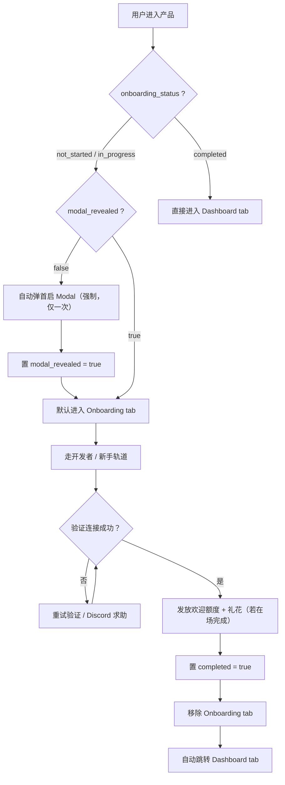
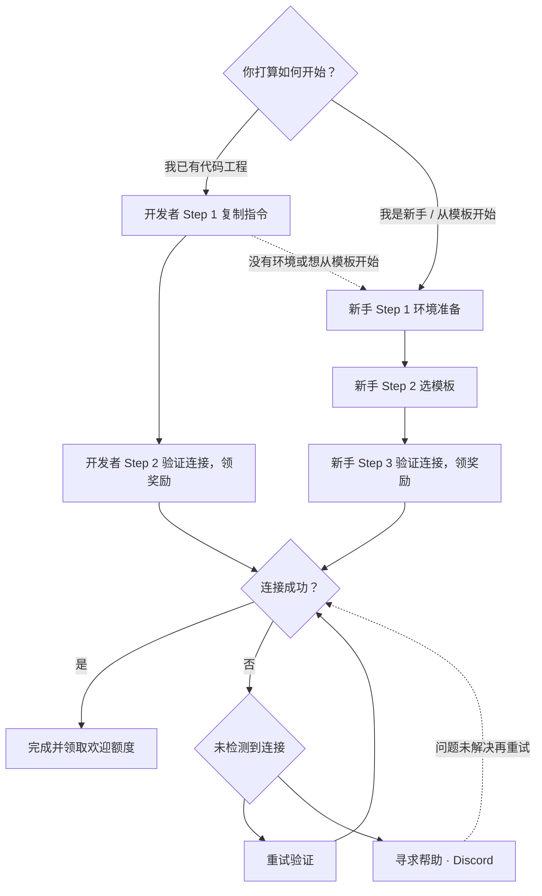

# Vectoree - 方案文档 - Onboarding 路径优化

---

## 1. 背景与目标

### 1.1 背景

Vectoree onboarding 的对外口号是 "Anyone can ship an agent!"。当前首次进入 Dashboard 的用户不清楚：

- 已有代码工程时，要把哪些命令粘贴到自己的编程代理里；
- 没有代码工程时，如何快速获得一个可运行项目；
- 执行完毕后，如何确认自己是否真正连接成功；
- 连接成功后是否已经拿到欢迎额度。

### 1.2 目标

1. 用户进入产品后，**按身份与意图分流**，而不是所有人都走同一条固定路径。
2. 为开发者提供 **1 秒可复制的连接指令**，不为难熟练用户。
3. 为新手提供 **Agent 环境安装 + Starter 项目启动提示词 + 连接验证** 的完整路径。
4. 把静态操作说明沉淀到 **Docs 指引页**，避免向导承载过长说明。
5. 首次进入产品强制弹一次引导 Modal，只弹一次；之后未完成用户进入 Onboarding tab 继续，完成后移除该 tab。
6. 提供全局常驻连接入口，用户随时可以重新发起连接。
7. 校验逻辑区分首次连接与非首次连接，避免重复发放欢迎额度。

---

## 2. 信息架构

### 2.1 左侧导航

```text
左侧导航
├─ Onboarding   ← 新增；完成首次连接前存在，完成后移除
├─ Dashboard    ← 保持现有数据看板内容
├─ ...其他入口
└─ 底部固定：设置 / 组织钱包余额
```


| 入口         | 内容              | 生命周期                |
| ---------- | --------------- | ------------------- |
| Onboarding | 首次连接任务清单 + 操作步骤 | 完成前存在，完成后自动移除       |
| Dashboard  | 现有数据看板          | 永久存在，不受影响           |
| 设置 / 组织钱包  | 现有内容            | 永久存在，不参与 Onboarding |


### 2.2 全局连接中心

导航栏右上角 `[🔌 连接]` 保持常驻，负责所有后续连接管理。


| 入口      | 定位                             |
| ------- | ------------------------------ |
| 右上角连接中心 | 永久常驻；复制当前项目极速指令、重新打开向导、跳转 Docs |


## 3. 状态机

```text
onboarding_status = not_started | in_progress | completed
modal_revealed   = true | false
```


| 字段                  | 含义                |
| ------------------- | ----------------- |
| `onboarding_status` | 账号级首次连接任务状态       |
| `modal_revealed`    | 首次引导 Modal 是否已展示过 |


| 状态            | 判定                      |
| ------------- | ----------------------- |
| `not_started` | 未跨过向导第一屏（未选择身份）         |
| `in_progress` | 已进入开发者 / 新手轨道，但尚未完成首次连接 |
| `completed`   | 已完成首次连接                 |


## 4. 触发与消失逻辑




### 4.1 首启 Modal

- 触发：`onboarding_status != completed` 且 `modal_revealed == false`。
- 首次进入产品时自动弹出，**强制且仅这一次**。
- 弹出后置 `modal_revealed = true`，之后任何场景都不再自动弹。


### 4.2 Onboarding tab

- 出现：`onboarding_status != completed`。
- 消失：`completed == true`，即完成首次连接后立即移除。
- 账号级任务，不随切组织 / 切项目 / 新增组织重新出现。


### 4.3 默认落点


| 场景                             | 默认进入的 tab      |
| ------------------------------ | -------------- |
| 未完成（not_started / in_progress） | Onboarding tab |
| 已完成（completed）                 | Dashboard tab  |


### 4.4 完成场景


| 完成位置                             | 礼花    | 后续表现                             |
| -------------------------------- | ----- | -------------------------------- |
| 在 Modal 或 Onboarding tab 上当场完成连接 | 放一次礼花 | 立即移除 Onboarding tab，跳转 Dashboard |
| 不在网页，在 CLI / Agent 中完成连接         | 不放礼花  | 邮件告知奖励，下次进站直接 Dashboard          |


## 5. 向导轨道




### 5.1 阶段 0：身份分流

弹窗 / Onboarding tab 第一屏提供两个单选卡片：

- `[🚀 我是开发者 / 我已有代码工程]`
- `[📦 我是新手 / 想从 Starter 模板开始]`

选择前者进入开发者轨道，共 2 步；选择后者进入新手轨道，共 3 步。

### 5.2 开发者轨道（2 步）


#### Step 1：复制指令

复制框内给出标准连接指令。

```text
请作为我的开发助手，在当前项目的本地终端中帮我运行以下命令以连接 Vectoree 后端：
npx @vectoree/cli login && npx @vectoree/cli link
```

- 指令下方保留回退入口：`没有环境或想从模板开始？[切换为新手模式]`。
- 不出 `cd` 目录切换指令，避免冗余。
- Agent 类型不影响该指令，所有 Agent 通用。


#### Step 2：验证连接，领奖励

用户点击「我已执行，验证连接」后，前端调用 `verify-connection`。

- 连接成功：进入完成态，发放欢迎额度。
- 未检测到连接：展开排查并允许重新验证或跳转 Discord 求助。


### 5.3 新手轨道（3 步）


#### Step 1：环境准备

展示可安装的 AI 编程代理下载卡片：

```text
Claude Code / Cursor / GitHub Copilot / Windsurf / Cline
```

- 必须确认已安装并打开任一编程代理，才能进入下一步。
- 防断流提示：

```text
💡 点击下载安装完成后，请返回本网页窗口继续完成后续连接步骤。
```


#### Step 2：选模板

展示 4 个 Starter 项目简介卡片，用户选择任一项目后，页面展示对应的一键复制提示词。


| 项目        | 简介                       |
| --------- | ------------------------ |
| DeepTutor | 创建我自己的 AI 学习教练           |
| RAGFlow   | 创建一个能检索我资料库的问答 Agent     |
| DeerFlow  | 创建一个能帮我调研、编程和干长任务的 Agent |
| LibreChat | 创建一个我自己的私有 AI 聊天助手       |


提示词结构为四段式，以 DeepTutor 为例：

```text
set up https://vectoree.ai/SKILL.md
Clone https://github.com/HKUDS/DeepTutor
Replace model serving, search, login/signup, database, and storage with Vectoree.
Follow the skill: login, link this directory, then run ai status.
```


| 段   | 内容                                                                  | 目的                      |
| --- | ------------------------------------------------------------------- | ----------------------- |
| 1   | `set up https://vectoree.ai/SKILL.md`                               | 让 Agent 安装 / 载入官方 Skill |
| 2   | `Clone <项目仓库>`                                                      | 将项目克隆到本地                |
| 3   | `Replace <对应能力> with Vectoree.`                                     | 将项目后端相应模块替换为 Vectoree   |
| 4   | `Follow the skill: login, link this directory, then run ai status.` | 绑定默认项目、连接并验证            |


#### Step 3：验证连接，领奖励

用户在 Agent 中执行完提示词后，回到页面点击「我已执行，验证连接」。

- 连接成功：进入完成态，发放欢迎额度。
- 未检测到连接：展开排查并允许重新验证或跳转 Discord 求助。


## 6. 校验与欢迎额度


### 6.1 校验接口

后端 `verify-connection` 返回两个独立标识：

```text
connection_success: boolean
user_rewarded_now: boolean
```

- `connection_success`：本次是否连接成功。
- `user_rewarded_now`：本次是否属于用户首次成功连接，需要发放欢迎额度。


### 6.2 首次成功连接

- 触发一次礼花动画。
- 文案：`🎉 项目已成功连接！$5.00 欢迎额度已发放至你的组织钱包`。
- 发放成功后自动发送欢迎额度邮件。


### 6.3 非首次成功连接

- 只展示轻量勾选成功动画。
- 文案：`🟢 项目已成功连接`。
- 不提示、不发放欢迎额度。


### 6.4 发放规则

- 由 Vectoree 后端在首次合格连接成功时发放，保证幂等。
- 奖励按用户维度只发一次，不随项目走。
- 示例：项目 A 连接失败，切到项目 B 成功，奖励在 B 成功时触发，但发放到用户组织钱包。
- Onboarding 页面只读取发放结果，不负责发放额度。


## 7. 异常与边界


| 场景            | 处理                                            |
| ------------- | --------------------------------------------- |
| 首次进入产品且未完成    | 强制弹一次 Modal，置 `modal_revealed = true`，之后不再自动弹 |
| 未完成用户再次进入     | 不弹 Modal，默认进入 Onboarding tab                  |
| 同账号切组织 / 切项目  | 不弹 Modal，Onboarding tab 不受影响                  |
| 同一会话内刷新       | 不重复弹 Modal                                    |
| 用户未安装编程代理     | 新手 Step 1 未选择代理时不可进入 Step 2                   |
| 开发者想改走模板路径    | 点击「切换为新手模式」进入新手轨道                             |
| 校验未检测到连接      | 展示排查信息，支持重新验证或 Discord 求助                     |
| 完成首次连接        | 移除 Onboarding tab，自动跳转 Dashboard tab          |
| 不在网页时完成连接     | 不放礼花、不弹 Modal；邮件告知奖励，回站直接 Dashboard           |
| 新增 / 切换到未连接组织 | Onboarding tab 不复活，由右上角连接中心负责                 |
| 后端发放失败        | 展示等待态，不错误提示                                   |


## 8. 研发对齐清单


### 前端

- [ ] 左侧新增 `Onboarding` 入口，完成前展示，完成后移除。
- [ ] 首次进入产品且 `modal_revealed == false` 时强制弹一次 Modal。
- [ ] 未完成用户默认进入 Onboarding tab，已完成用户默认进入 Dashboard tab。
- [ ] 开发者轨道：复制指令框 + 「切换为新手模式」回退入口。
- [ ] 新手轨道：4 个 Starter 项目卡片，选中后复制生产环境配置提示词。
- [ ] 在 Modal 或 Onboarding tab 当场完成连接时触发一次礼花。
- [ ] 完成连接后移除 Onboarding tab，并自动跳转 Dashboard tab。
- [ ] 右上角连接中心保持常驻。


### 后端

- [ ] 维护账号级 `onboarding_status` 与 `modal_revealed`。
- [ ] 提供 `verify-connection` 校验接口。
- [ ] 返回 `connection_success` 与 `user_rewarded_now` 两个字段。
- [ ] 首次连接且满足资格时发放 $5.00 欢迎额度，保证幂等。
- [ ] 欢迎额度发放成功后自动触发邮件通知。


### 数据依赖

- [ ] 4 个 Starter 项目简介与启动提示词读取生产环境既有配置。
- [ ] 提示词结构以 `set up Skill → Clone → Replace → Follow skill` 为准。