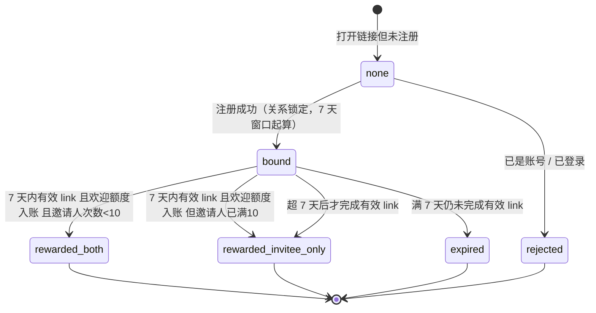
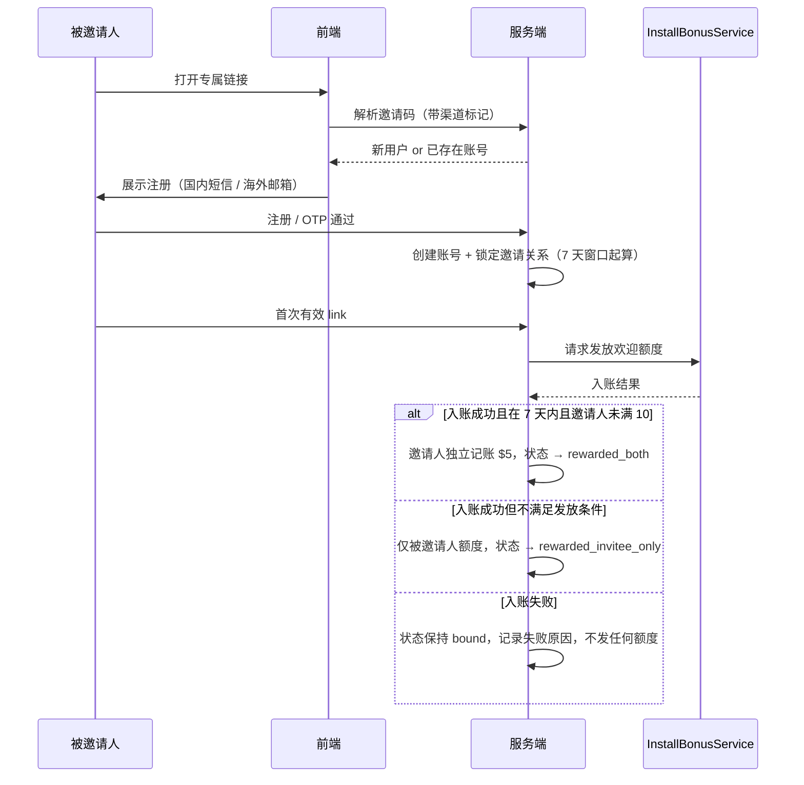

# Vectoree - 需求文档 - 邀请裂变第一期

> **本文与一份已交付的 HTML 前端配套**：前端由产品侧改完并交付源码，研发按本文补齐后端、数据库与埋点实现。
>
> **边界约定**：HTML 里能看到的（布局、样式、文案、静态交互、前端状态切换）以 HTML 源码为准，本文不复述；HTML 里看不到或只是 mock 的（接口、数据落库、服务端判定、权限、限流、异步任务）以本文为准。**两者冲突时先停下确认，不要自行裁决。**
>
> **每条规则只在一个地方定义**，其他位置只引用章节号、不复述。
>
> **规则来源**：[Vectoree - 规则定稿 - 邀请裂变第一期](../03_Execution/02_PRD/Vectoree%20-%20规则定稿%20-%20邀请裂变第一期.md)。本文是该规则文档的工程落地形态，规则口径与规则定稿一致；如有不一致，以规则定稿为准并回改本文。

---

## 0 文档信息

### 0.1 变更记录

| 日期 | 变更摘要 |
| - | - |
| | |

### 0.2 交付物清单

| 类型 | 内容 | 位置 |
| - | - | - |
| 前端 HTML | 邀请裂变第一期页面（邀请人页 + 被邀请人落地页 + 注册后状态页） | 待填 |
| 规则定稿 | Vectoree - 规则定稿 - 邀请裂变第一期 | 本库 `03_Execution/02_PRD/` |
| 本需求文档 | 本文 | 本库 `03_Execution/02_PRD/` |

### 0.3 前端交付说明

| 项 | 内容 |
| - | - |
| 交付形态 | 单文件 HTML，含三页：一页通过 `?role=inviter` 切换的邀请人页、一页被邀请人落地页、一页注册后状态页 |
| 如何查看 | 直接打开本地文件；三页之间用顶部切页按钮跳转，无后端依赖 |
| 需登录态查看的页面 | 否。本期 HTML 为免登录 mock |
| **HTML 中的 mock 面** | ① 登录态：HTML 无登录，所有「当前用户」为写死的 `DEMO_INVITER = { id: 'u_demo_001', name: 'Demo 邀请人' }`；② 邀请码：写死 `DEMO_CODE = 'VECT-2026-DEMO'`，非真实生成；③ 邀请记录：写死 4 条数组 `DEMO_RECORDS`，分别对应已发放 / 邀请人未得 / 进行中 / 已逾期；④ 名额：写死 `10`；⑤ 复制：仅调用 `navigator.clipboard`，无失败分支处理；⑥ 进度计算：全部在前端写死，无接口 |
| **HTML 不可信的部分** | 顶部「切页 / 切换演示数据」控制条；`DEMO_*` 常量；记录列表里的具体金额与时间。**以上全部禁止照抄进生产** |

> HTML 里「已发放」只有一种视觉表现，规则定稿 §4.4 要求区分「邀请人拿到自己的 $5」与「对方拿到但邀请人没拿到」。本文 §4.2 已按两态拆开，研发按本文实现，不要抄 HTML。

### 0.4 发布计划

- **计划发布时间**：待研发确认排期后填入
- **是否需灰度 / 回滚预案**：是。发奖逻辑需开关，可关闭发奖但保留关系记录（见 §6.3）

### 0.5 关联文档

| 文档 / 现网对象 | 关系 |
| - | - |
| Vectoree - 规则定稿 - 邀请裂变第一期 | 规则来源，本文与其对齐 |
| 现网 `InstallBonusService` | 被邀请人 $5 欢迎额度的生产发奖器；本文 §6.2 与其对齐，**本期不改其「到期未充值收回」行为** |
| 现网 `device_hash` 机制 | 同设备多账号的风控依据，§4.5 引用 |

---

## 1 需求背景与目标

### 1.1 要解决的问题

Vectoree 的价值在用户把本地工程接上后端之后才成立，而当前增长完全依赖自然流量与手动分享，没有内建的裂变机制。已激活用户缺少把「用得起来」转化为「拉人进来」的正向激励，新用户也没有除欢迎额度之外的额外动机。

本需求建立**用户对用户的邀请裂变**：已激活用户用专属链接拉新用户，新用户完成激活后双方各得 $5 平台额度。

成功指标是**有效激活**（被邀请人完成首次有效 `link` 且欢迎额度实际入账），不是注册数、不是链接点击数。

### 1.2 本期范围

**做：**

| 类型 | 模块 |
| - | - |
| 新做 | 账号级「邀请好友」页（入口、专属链接、名额与记录展示） |
| 新做 | 邀请关系锁定（注册成功时）与两笔 $5 的发放 |
| 新做 | 被邀请人落地页（新用户识别与引导） |
| 新做 | 专属链接的生成与重置 |
| 改现有模块 | 注册链路：需在注册成功处插入关系锁定 |
| 改现有模块 | 被邀请人落地页的注册方式分流（国内短信 OTP / 海外邮箱） |

**不做（明确排除）：**

| 项 | 说明 |
| - | - |
| 分佣与提现 | 本期只发平台额度，不发现金，不可提现 |
| 多级返利 | 无 |
| 拉同事进组织 | 走组织「成员管理」，与裂变是两条链路，不合并 |
| 审批加入 / 邮箱直加 / 通过上限 | 组织成员管理能力，本期不动 |
| 站内信 / 邮件通知 | 第一期不做 |
| 排行榜 / Waitlist / 按仓库质量结算 | 不做 |
| 按被邀请人后续真实扣费再发邀请人奖励 | 第一期按 `link` 成功即发 |
| 修改现网欢迎额度「到期未充值收回」行为 | 被邀请人那笔 $5 走现网发奖器，行为不变 |
| 邀请页展示「未充值收回」文案 | 不写这句 |

> 「不做」中最容易被误实现的是**拉同事进组织**与**裂变的边界**。两者入口必须分开，研发不要复用成员邀请的 `oi_` token、join 路由、审批、默认角色、邮箱直加。

### 1.3 成功度量

| 指标 | 定义 | 埋点口径 |
| - | - | - |
| 邀请转化率 | 有效激活数 ÷ 专属链接点击数 | §7.5 步骤 3 / 步骤 1 |
| 裂变贡献新用户数 | 通过邀请关系注册且完成激活的新用户数 | §7.5 步骤 6 |
| 名额用尽率 | 达到 10 次成功的邀请人数占比 | §7.4 `invite_quota_reached` |
| 逾期流失率 | 已逾期关系数 ÷ 已绑定关系数 | §7.5 步骤 6 |

---

## 2 需求概述

本期给已激活用户一个账号级的「邀请好友」能力：他完成自己的 `link` 后系统自动生成一条长期专属链接，被邀请人通过该链接完成注册并连接项目后，双方各得 $5 平台额度；每个邀请人最多成功邀请 10 人。邀请关系在被邀请人注册成功那一刻锁定并开始 7 天窗口，逾期后被邀请人仍可得自己的 $5、邀请人不再得。

与现在的差别：现在没有邀请裂变入口、没有邀请关系、没有这 $5 的发放；组织成员管理只解决「拉同事进组织」，不产生奖励。**这两个入口不能合并。**

**核心功能点一览：**

| # | 功能点 | 一句话说明 | 涉及页面 | 优先级 |
| - | - | - | - | - |
| 1 | 专属链接生成与重置 | 邀请人自己 `link` 成功后自动生成一人一条长期链接，可重置 | §5.1 | P0 |
| 2 | 名额与规则展示 | 展示剩余可成功邀请次数（上限 10）与规则文案 | §5.1 | P0 |
| 3 | 邀请记录展示 | 展示每条关系的状态，区分邀请人是否拿到自己的 $5 | §5.1 | P0 |
| 4 | 被邀请人落地 | 新用户经专属链接进入，识别为新用户并引导注册 | §5.2 | P0 |
| 5 | 关系锁定 | 被邀请人注册成功时锁定关系并起算 7 天窗口 | §5.2 | P0 |
| 6 | 双边发奖 | 条件满足时邀请人与被邀请人各入账 $5 | §5.3 | P0 |
| 7 | 账户已验证判定 | 领奖条件为「邮箱验证或短信 OTP 二选一」 | §5.2 | P0 |

---

## 3 需求涉及范围

### 3.1 涉及页面 / 模块总览

| # | 路径 | 页面 / 模块 | 改动性质 | 前端是否已交付 | 研发需完成 |
| - | - | - | - | - | - |
| 1 | `/referral`（拟） | 账号级「邀请好友」页 - 链接与复制区 | 新增 | 是 | 链接生成接口、复制状态上报 |
| 2 | `/referral` | 账号级「邀请好友」页 - 名额与规则区 | 新增 | 是 | 名额查询接口（已成功次数 / 上限） |
| 3 | `/referral` | 账号级「邀请好友」页 - 邀请记录列表 | 新增 | 是 | 记录列表接口、状态枚举返回 |
| 4 | `/referral` | 「未连接」前置态 | 新增 | 是 | 前置态判定接口 |
| 5 | `/auth/invite`（拟） | 被邀请人落地页 - 新用户识别与引导 | 新增 | 是 | 邀请码解析接口、渠道标记透传 |
| 6 | 注册链路 | 注册成功回调处 | 修改 | 部分 | **关系锁定插入点**、渠道落库 |
| 7 | 额度发放 | 邀请人 $5 独立记账 | 新增 | 否 | 发奖实现、幂等、开关 |
| 8 | 侧边栏 / 用户菜单 | 「邀请好友」入口 | 新增 | 是 | 入口位置与显隐（账号级，不进组织成员管理） |

### 3.2 需删除的现网逻辑

| # | 位置 | 现状行为 | 本期处理 | 不删的后果 |
| - | - | - | - | - |
| 1 | 待与研发确认具体位置 | 邀请码若有「事后补填」入口 | **必须删除** | 允许事后补填会破坏「关系在注册成功时锁定」，且可被用于自邀刷额度 |
| 2 | 组织成员邀请的裂变相关文案 | 若成员管理页出现发放额度类文案 | **必须删除** | 用户会认为拉同事也能拿 $5，与裂变规则冲突 |

> 若上述两项在现网不存在，记录「现网无此逻辑」即可，不要为了填表而虚构删除项。

### 3.3 明确不动的部分

| 位置 | 为什么不碰 |
| - | - |
| 现网 `InstallBonusService` | 被邀请人 $5 复用它；本期不改其「到期未充值收回」行为 |
| 组织「成员管理」全链路 | 拉同事是另一条产品，不合并入口、不复用 `oi_` token / join 路由 / 审批 / 默认角色 / 邮箱直加 |
| 现网欢迎额度领取页 | 被邀请人 Billing 若仍出现「到期未充值收回」文案，那是欢迎额度页，不是裂变页，不改 |

### 3.4 影响面

| 类型 | 影响 | 说明 |
| - | - | - |
| 现网其他页面 | 注册成功落地页 | 需承载邀请渠道标记并透传 |
| 现网服务 | `InstallBonusService` | **只被调用，不修改** |
| 现网数据表 | 邀请关系、邀请人奖励记账 | 新增 |
| 异步任务 | 无 | 本期无定时任务；额度过期沿用现网欢迎额度机制 |
| 第三方 / 外部回调 | 无 | |

---

## 4 流程与逻辑

### 4.1 主流程（ASCII 分支树）

```
邀请人进入「邀请好友」页
  ↓
判断：邀请人自己是否已 link 成功？
  ├─ 否 → 展示「先连接项目」前置态，不生成也不展示链接（§5.1.4）
  └─ 是 → 自动生成/读取一人一条长期专属链接，展示名额与记录
              ↓
        被邀请人打开专属链接
              ↓
        判断：该用户是否已有 Vectoree 账号？
        ├─ 是（含已登录） → 不绑定、不发奖
        │                 → 提示「链接仅限新用户」
        │                 → 引导去自己的「邀请好友」页（§4.4 场景 1）
        └─ 否 → 展示落地页，按站点分流注册方式
                  国内站 → 短信 OTP 注册
                  海外站 → 邮箱注册
                          ↓
                    注册成功 = 账号已验证（二选一已满足）
                    锁定邀请关系，记录 channel = invite_link
                    ★ 7 天窗口从此刻起算
                          ↓
                    7 天内完成首次有效 link，且欢迎额度实际入账？
                    ├─ 是 → 判断：邀请人成功次数 < 10 且本人未逾期？
                    │         ├─ 是 → 双方各 $5 入账 → rewarded_both（§4.2）
                    │         └─ 否 → 只发被邀请人欢迎额度
                    │                   → rewarded_invitee_only（§4.2）
                    └─ 否 → 判断：是否超 7 天？
                              ├─ 否（link 了但没过发奖条件）
                              │     → 双方均不发，记录保持 bound，
                              │       可后续再判定（§4.4 场景 5）
                              └─ 是 → expired
                                    被邀请人若之后满足现网发奖条件，
                                    自己的 $5 仍发；邀请人不发
```

**关系在「被邀请人注册成功」时锁定，不绑渠道。** 点了链接一直没注册，关系不锁、7 天窗口不起算。

### 4.2 状态机（Mermaid）



**状态定义表：**

| 状态 | 含义 | 进入条件 | 停留 | 下一状态 |
| - | - | - | - | - |
| `none` | 未锁定，无关系 | 打开链接未注册 | 无限 | `bound` / `rejected` |
| `rejected` | 不绑定、不发奖 | 打开链接时已有账号或已登录 | 终态 | — |
| `bound` | 已锁定，进行中 | 被邀请人注册成功那一刻 | 至有效 `link` 入账或满 7 天 | `rewarded_both` / `rewarded_invitee_only` / `expired` |
| `rewarded_both` | 双方均已发放 | `bound` 期内完成有效 `link` 且欢迎额度入账，且邀请人成功次数 < 10 | 终态 | — |
| `rewarded_invitee_only` | 仅被邀请人发放 | ① 期内完成但邀请人已满 10 次；② 期内完成但对方风控未入账；③ 超 7 天后才完成 | 终态 | — |
| `expired` | 超 7 天未完成 | 距注册成功满 7 天且仍未完成有效 `link` | 终态 | — |

> **`rewarded_both` 与 `rewarded_invitee_only` 必须能区分。** HTML 里「已发放」只有一种标签，研发按本表实现两态返回，前端才能显示「已发放（你没拿到）」。合并会导致用户看到自己没到账却显示已发放。

### 4.3 关键时序（Mermaid）



### 4.4 判断逻辑与分支条件

| # | 判断点 | 判定条件 | 条件成立 | 条件不成立 |
| - | - | - | - | - |
| 1 | 专属链接是否生成 | 邀请人自己首次 `link` 成功 | 自动生成一人一条长期链接 | 「邀请好友」页只展示「先连接项目」，不生成也不展示链接 |
| 2 | 打开链接的用户可否绑定 | 该邮箱/手机号在系统内无账号 | 展示注册页并在注册成功时锁定关系 | 不绑定、不发奖；提示仅限新用户；引导去自己的邀请页 |
| 3 | 关系何时锁定 | 被邀请人**注册成功**那一刻 | 落库关系，`channel = invite_link`，7 天窗口起算 | 未注册则关系不锁、窗口不起算 |
| 4 | 领奖的账号验证条件 | 邮箱验证 **或** 短信 OTP，二选一 | 视为已验证 | 两者均无则不进入领奖判定；邀请人也不发 |
| 5 | 邀请人是否发放 | ① 距被邀请人注册成功 ≤ 7 天；② 邀请人成功次数 < 10；③ 被邀请人欢迎额度**实际入账** | 邀请人 $5 入账，状态 `rewarded_both` | 不发，状态 `rewarded_invitee_only` |
| 6 | 重置链接后进行中关系 | 该关系已在旧链下锁定且仍在 7 天窗口内 | 仍按原绑定结算 | — |
| 7 | 满 10 次后新用户仍注册并 `link` | — | 被邀请人照常拿自己的 $5 | 邀请人不再发第 11 笔 |

### 4.5 异常与边界

| # | 场景 | 触发条件 | 系统行为 | 用户可见表现 | 数据是否落库 |
| - | - | - | - | - | - |
| 1 | 已有账号点链接 | 系统内已存在该邮箱/手机号 | 不绑定、不发奖 | 提示仅限新用户，引导去自己的「邀请好友」 | 不落关系 |
| 2 | 登录态点自己的链接 | 邀请人点自己链接 | 同场景 1 | 同上 | 不落关系 |
| 3 | 同设备多账号 | 现网 `device_hash` 命中 | 被邀请人领不到欢迎额度，邀请人也不发 | 被邀请人侧不发奖；邀请人记录显示未发放 | 关系落库，状态 `rewarded_invitee_only` |
| 4 | 重置链接 | 邀请人点重置 | 旧链立即失效；已锁定且在窗口内的进行中关系继续按原绑定结算 | 复制到的是新链 | 关系不变 |
| 5 | 7 天内 `link` 但未过发奖条件 | 邮箱未验 / 同设备已领 / 组织已充值 | 双方均不发 | 记录保持进行中；被邀请人页面无额度到账提示 | 关系落库，状态保持 `bound`，记录失败原因 |
| 6 | 超 7 天才 `link` 且过发奖条件 | 距注册成功 > 7 天 | 被邀请人欢迎额度照发；邀请人不发 | 记录显示「已逾期」；被邀请人仍到账 | 关系落库，状态 `rewarded_invitee_only` |
| 7 | 并发 / 重复结算 | 同一关系被重复触发发奖 | 幂等：以先落库者为唯一发放方，重复调用返回首次结果 | 无重复到账 | 只记一笔发放 |
| 8 | 邀请码无效 / 已重置 | 解析不到有效邀请码 | 走自然注册，`channel = direct` | 正常注册，无邀请相关提示 | 不落关系 |
| 9 | 满 10 次后新用户注册并 `link` | 邀请人成功次数已达 10 | 被邀请人照常发；邀请人不发 | 邀请人页显示已达上限；进行中的人按完成先后占名额 | 关系落库，状态 `rewarded_invitee_only` |
| 10 | 组织拉同事 | 走成员管理链路 | 不进入本裂变发放逻辑 | 成员管理页不出现 $5 额度文案 | 不落本关系 |

---

## 5 需求说明（分页面详讲）

### 5.1 邀请人「邀请好友」页

#### 5.1.1 路径定位

| 项 | 内容 |
| - | - |
| 路由 | `/referral`（拟，账号级） |
| 前端文件 | 见 §0.2 交付物清单 |
| 入口来源 | 用户菜单 / 侧边栏**账号级**独立入口。**不进组织「成员管理」** |
| 离开方式 | 返回上一页 |
| 需登录 | 是。未登录跳登录，登录后回本页 |

#### 5.1.2 页面职责

让已激活用户看到自己的邀请进度：拿到专属链接、知道还剩几次成功机会、看清每条邀请的结算状态。

#### 5.1.3 模块拆解

| # | 模块 | 位置 | 功能 | 关键交互 | 优先级 |
| - | - | - | - | - | - |
| 1 | 前置态 | ① | 未 `link` 时替代整个链接区 | 按钮跳连接引导 | P0 |
| 2 | 链接与复制区 | ② | 展示专属链接、复制、重置 | 复制 / 重置 | P0 |
| 3 | 名额与规则区 | ③ | 剩余可成功邀请次数 + 规则文案 | 无 | P0 |
| 4 | 邀请记录列表 | ④ | 每条关系的状态与时间 | 无 | P0 |

#### 5.1.4 各模块规则详述

**① 前置态（未 `link`）**

- **展示规则**：邀请人自己尚未完成首次有效 `link` 时展示，替换②③④
- **交互**：主按钮跳到连接引导
- **用户可见文案**（逐字）：

| 场景 | 文案 |
| - | - |
| 标题 | 先连接项目 |
| 说明 | 连接成功后即可邀请好友，双方各得 $5 额度 |
| 按钮 | 去连接 |

**② 链接与复制区**

- **展示规则**：邀请人已完成首次有效 `link` 时展示；链接由服务端生成，一人一条长期有效
- **数据来源**：`invite_code`（字符串，长期有效链接）、`invite_url`（完整 URL）
- **交互逻辑**：
  - 点击复制 → 写入剪贴板。成功与失败分别上报埋点（§7.4）
  - 点击重置 → 旧链立即失效；**已锁定且仍在 7 天窗口内的进行中关系继续按原绑定结算**（§4.4 判断 6）
- **边界**：
  - 复制失败：提示「复制失败，请手动选中复制」，不静默失败
  - 加载中：链接区骨架屏，不展示空字符串
  - 未 `link` 成功时**不展示任何链接**（不展示占位或无效码）

**③ 名额与规则区**

- **展示规则**：常驻展示剩余可成功邀请次数
- **数据来源**：`invited_success_count`（已成功次数，0–10）、`invite_quota`（上限，固定 10）、剩余 = 上限 − 已成功次数
- **达到上限时**：展示「已达上限」，专属链接**仍可被新用户使用**，被邀请人照常拿自己的 $5，邀请人不再发（§4.5 场景 9）
- **用户可见文案**（逐字）：

| 场景 | 文案 |
| - | - |
| 名额 | 最多成功邀请 10 人，已成功邀请 {n} 人 |
| 达上限 | 你已达到邀请上限，链接仍可继续分享 |
| 规则条目 1 | 新用户成功连接项目后得 $5 额度，邀请人同时得 $5 额度 |
| 规则条目 2 | 你需要先成功连接自己的项目，才能邀请 |
| 规则条目 3 | 对方注册后 7 天内完成连接，你才能拿到邀请奖励；逾期对方仍可得自己的 $5，你不再得 |
| 规则条目 4 | 链接只对新用户有效，不能事后补填邀请码 |
| 规则条目 5 | 额度进入组织钱包，可在 30 天内用来跑 AI / 网关 |
| 规则条目 6 | 额度不是现金、不能提现；邀请同事进团队走成员管理，不走这条 |

> **不写「未充值收回」。** 额度到账后 30 天是产品页文案口径；被邀请人那笔 $5 走现网欢迎额度发奖器，其「到期未充值收回」行为本期不变，但**不在本页文案出现**。

**④ 邀请记录列表**

- **展示规则**：展示当前邀请人名下的全部邀请关系，按创建时间倒序
- **数据来源**：记录数组，每条含 `id`、`invitee_masked`（脱敏）、`registered_at`、`status`（见 §6.1）、`inviter_rewarded`（布尔，用于区分两态）、`fail_reason`
- **状态标签映射**（**必须能区分两态**，HTML 未区分）：

| `status` | `inviter_rewarded` | 标签文案 | 补充说明 |
| - | - | - | - |
| `bound` | — | 进行中 | 附「剩余 {n} 天」 |
| `rewarded_both` | `true` | 已发放 | 双方各 $5 已入账 |
| `rewarded_invitee_only` | `false` | 已发放（未发放你的额度） | 对方已得 $5；你未发放的原因见下 |
| `rewarded_invitee_only` | `false` | 已发放（未发放你的额度） | 按满 10 次 / 对方风控未入账 / 超 7 天 区分 `fail_reason` 文案 |
| `expired` | `false` | 已逾期 | 对方仍可能拿到自己的 $5 |

- **边界**：
  - 空态：文案「还没有邀请记录」+ 副文案「复制专属链接发给朋友，双方各得 $5 额度」+ 主按钮「复制链接」
  - 加载中：列表骨架屏，固定行高，不展示 `0` 或 `null`
  - 分页：本期一次返回全部，不做分页；若后续加分页，需先更新本文

#### 5.1.5 状态与边界

| # | 状态 | 判定条件 | 界面表现 | 可否重试 / 下一步 |
| - | - | - | - | - |
| 1 | 前置态 | 邀请人未完成首次有效 `link` | 仅① | 去连接 |
| 2 | 加载中 | 链接 / 名额 / 记录请求未回 | 各区骨架屏 | — |
| 3 | 正常 | 已 `link` 且请求成功 | ②③④ | — |
| 4 | 空记录 | 正常态但记录数为 0 | ④空态 | 复制链接 |
| 5 | 已达上限 | `invited_success_count >= 10` | ③显示已达上限，②仍可分享 | — |
| 6 | 接口失败 | 任一请求失败 | 该区错误态 + 重试按钮，不影响其他区展示 | 重试 |
| 7 | 未登录 | 无登录态 | 跳登录，登录后回本页 | — |

#### 5.1.6 研发交付要点

| # | 要做什么 | 依赖 | 验收标准 |
| - | - | - | - |
| 1 | 专属链接生成与读取接口；未 `link` 时返回前置态判定 | 现网 `link` 成功状态 | 未 `link` 时不返回任何链接 |
| 2 | 重置链接接口；旧链立即失效且不影响已锁定关系 | 关系表 | 重置后旧码解析返回无效，进行中关系仍可结算 |
| 3 | 名额查询接口（已成功次数 / 上限） | 记账表 | 达 10 时返回上限态 |
| 4 | 邀请记录列表接口，返回 `status` + `inviter_rewarded` + `fail_reason` | 关系表 | 能区分 `rewarded_both` 与 `rewarded_invitee_only` |
| 5 | 复制成功 / 失败分别上报埋点 | §7.4 | 失败路径也上报 |
| 6 | 页面文案按 §5.1.4 逐字落地 | — | 不出现「未充值收回」 |

---

### 5.2 被邀请人落地与关系锁定

#### 5.2.1 路径定位

| 项 | 内容 |
| - | - |
| 路由 | `/auth/invite`（拟，携带邀请码） |
| 前端文件 | 见 §0.2 |
| 入口来源 | 专属链接直接打开 |
| 离开方式 | 完成注册后进入 Dashboard |
| 需登录 | 否。已登录时按 §4.5 场景 1、2 处理 |

#### 5.2.2 页面职责

识别打开链接的人是不是新用户；是则引导其完成注册，从而锁定邀请关系并起算 7 天窗口。

#### 5.2.3 模块拆解

| # | 模块 | 位置 | 功能 | 关键交互 | 优先级 |
| - | - | - | - | - | - |
| 1 | 邀请关系识别区 | ① | 解析邀请码、判断新用户 / 已有账号 | 无 | P0 |
| 2 | 注册引导区 | ② | 国内短信 OTP / 海外邮箱注册 | 完成注册 | P0 |
| 3 | 已有账号提示区 | ③ | 已有账号 / 已登录时的提示与引导 | 跳自己邀请页 | P0 |

#### 5.2.4 各模块规则详述

**① 邀请关系识别区**

- **数据来源**：解析结果含 `is_new_user`（布尔）、`invite_code`（有效时）、`channel`（`invite_link` / `direct`）
- **边界**：
  - 邀请码无效 / 已重置 → `channel = direct`，走自然注册，**不展示任何邀请相关提示**（§4.5 场景 8）
  - 解析失败不阻塞注册，注册照常可完成

**② 注册引导区**

- **展示规则**：`is_new_user = true` 时展示
- **分流规则**：同一条专属链接，**国内站落地短信注册 / 登录，海外站落地邮箱**；邀请关系在注册成功时绑定，**不绑渠道**
- **锁定时点**：**注册成功那一刻**锁定关系并起算 7 天窗口（§4.4 判断 3）
- **账号已验证**：领奖条件为「邮箱验证 **或** 短信 OTP」二选一。**短信 OTP 成功 = 注册成功 = 锁定关系 = 视同已验证**，不要强制短信用户再绑邮箱
- **边界**：
  - 仍有邮箱的用户需拦截一次性邮箱
  - 验证码失败 / 过期：留在注册态并给出对应提示，不锁定关系

**③ 已有账号提示区**

- **展示规则**：`is_new_user = false`（含已登录、含邀请人点自己链接）时展示
- **系统行为**：不绑定、不发奖
- **用户可见文案**（逐字）：

| 场景 | 文案 |
| - | - |
| 标题 | 该链接仅限新用户 |
| 说明 | 你已有 Vectoree 账号，无法通过此链接接受邀请 |
| 按钮 | 去我的邀请好友页 |

#### 5.2.5 状态与边界

| # | 状态 | 判定条件 | 界面表现 | 可否重试 / 下一步 |
| - | - | - | - | - |
| 1 | 解析中 | 邀请码解析请求未回 | 骨架屏 | — |
| 2 | 新用户 | `is_new_user = true` 且邀请码有效 | ①② | 完成注册 |
| 3 | 已有账号 | `is_new_user = false` | ③ | 去邀请页 |
| 4 | 无效邀请码 | 解析不到有效码 | 仅②，无邀请提示 | 完成注册（自然注册） |
| 5 | 注册失败 | 验证码错误 / 频控 | 留在②，错误提示 | 重试 |

#### 5.2.6 研发交付要点

| # | 要做什么 | 依赖 | 验收标准 |
| - | - | - | - |
| 1 | 邀请码解析接口，区分新用户 / 已有账号 / 无效码 | 关系表 | 无效码不报错，走 `direct` |
| 2 | **在注册成功处插入关系锁定**，写入 `channel = invite_link` | 注册链路 | 锁定时点精确到注册成功，非注册开始 |
| 3 | 7 天窗口起算点为注册成功时间 | 关系表 | 起算点不取邀请人注册时间 |
| 4 | 账号已验证判定改为「邮箱验证或短信 OTP」 | 现网验证逻辑 | 短信用户不被强制要求绑邮箱 |
| 5 | 一次性邮箱拦截保留在有邮箱的分支 | 现网邮箱校验 | — |

---

### 5.3 双边发奖

#### 5.3.1 路径定位

| 项 | 内容 |
| - | - |
| 路由 | 无独立页面。由被邀请人首次有效 `link` 触发 |
| 前端文件 | — |
| 入口来源 | 被邀请人完成首次有效 `link` 且欢迎额度入账 |
| 需登录 | 是（双方均需登录态） |

#### 5.3.2 页面职责

无页面。这是纯服务端逻辑，落在 §6 接口与数据语义。此处单列是为了让「发奖何时发生」在需求侧有明确归属。

#### 5.3.3 规则详述

| 谁 | 怎么发 | 怎么花 | 到期 |
| - | - | - | - |
| 被邀请人 | **复用现网欢迎额度（`InstallBonusService`）**，不加码 | 默认组织钱包 | 走现网欢迎额度行为；**本期不改其「到期未充值收回」**。裂变页文案不写这句 |
| 邀请人 | **独立一笔记账**，仅当对方欢迎额度**真正入账**、且本人成功次数 < 10、且在 7 天内 | 默认组织钱包，同样靠使用消耗 | 产品页写「入账后 30 天」，**不套用「未充值收回」** |

- 同一对邀请关系**只结算一次**邀请人奖励
- 「真正入账」的判定以服务端发放记录为准，不以前端到账提示为准
- 默认空项目算有效 `link`
- 条件不满足时**不阻塞、不报错、不提示**，静默不发（前端不展示失败态）

#### 5.3.4 研发交付要点

| # | 要做什么 | 依赖 | 验收标准 |
| - | - | - | - |
| 1 | 被邀请人侧：调用现网 `InstallBonusService`，不改其逻辑 | 现网服务 | 行为与现网完全一致 |
| 2 | 邀请人侧：独立记账，仅在三条条件同时满足时发放 | 记账表 | 任一条件不满足即不发 |
| 3 | 幂等：同一关系重复触发只发一次 | 关系唯一约束 | 并发下不重复发放 |
| 4 | 成功次数计数：按**成功次数**计，不按发出去的链接人数计 | 记账表 | 逾期与未发放不占名额 |
| 5 | 全程不产生用户可见的失败提示 | — | 失败场景前端无报错态 |

---

## 6 数据与接口约定

### 6.1 数据实体与字段语义

**邀请关系**

| 业务名 | 业务含义 | 取值 / 枚举 | 谁产生 | 谁消费 |
| - | - | - | - | - |
| 关系 id | 一条邀请关系唯一标识 | 字符串 | 服务端 | 前端记录列表 |
| 邀请人 | 发起邀请的用户 | 用户 id | 服务端 | 服务端 |
| 被邀请人 | 被邀请的用户 | 用户 id | 服务端锁定时写入 | 服务端 |
| `channel` | 来源渠道 | `invite_link`（专属链接）/ `direct`（自然注册） | 服务端 | 埋点、统计 |
| 锁定时间 | 被邀请人注册成功时刻，**7 天窗口的起算点** | 时间戳 | 服务端 | 逾期判定 |
| `status` | 关系状态 | `none` / `bound` / `rewarded_both` / `rewarded_invitee_only` / `expired` / `rejected` | 服务端 | 前端标签、埋点 |
| `inviter_rewarded` | 邀请人是否拿到自己的 $5 | `true` / `false` | 服务端 | 前端标签区分 |
| `fail_reason` | 未发放原因 | `quota_exhausted`（满 10）/ `risk_rejected`（风控未入账）/ `window_expired`（超 7 天） | 服务端 | 前端说明文案 |

> **`status` 六个值必须全返回。** 前端「已发放」标签依赖 `status` + `inviter_rewarded` 组合区分两态，缺任一字段前端都会渲染成同一种。

**邀请人奖励记账**

| 业务名 | 业务含义 | 取值 | 谁产生 |
| - | - | - | - |
| 记账 id | 一笔邀请奖励 | 字符串 | 服务端 |
| 邀请人 | 获邀人 | 用户 id | 服务端 |
| 关系 id | 关联的邀请关系，**用于幂等** | 字符串 | 服务端 |
| 金额 | 本期固定 $5 | 金额 | 服务端 |
| 入账时间 | 实际入账时刻 | 时间戳 | 服务端 |
| TTL | 到期时间 | 入账时间 + 30 天 | 服务端 |

### 6.2 接口清单（业务语义层）

| # | 接口用途 | 触发时机 | 调用方 | 关键入参 | 关键出参 | 幂等要求 | 失败语义 |
| - | - | - | - | - | - | - | - |
| 1 | 获取我的专属链接与名额 | 进入邀请页 | 前端 | 当前登录用户 | `invite_url`、`invited_success_count`、`invite_quota`、`linked`（前置态判定） | 可重复 | 未登录跳登录；失败返回错误态 |
| 2 | 重置专属链接 | 点击重置 | 前端 | 当前登录用户 | 新 `invite_url` | **必须**：重复点击只产生一条新链，旧链立即失效 | 失败返回错误态，不改旧链 |
| 3 | 邀请记录列表 | 进入邀请页 | 前端 | 当前登录用户 | 记录数组（含 `status`、`inviter_rewarded`、`fail_reason`） | 可重复 | 失败仅该区错误态 |
| 4 | 解析邀请码 | 被邀请人打开链接 | 前端 | `invite_code` | `is_new_user`、`channel` | 可重复 | 解析失败按 `direct` 处理，**不阻塞注册** |
| 5 | 锁定邀请关系 | **被邀请人注册成功那一刻** | 服务端内部 | 邀请码、被邀请人 id | 关系 id、锁定时间 | **必须**：同一被邀请人只锁一条关系 | 锁定失败不阻断注册，关系不落库 |
| 6 | 双边发奖 | 被邀请人首次有效 `link` 且欢迎额度入账后 | 服务端内部 | 关系 id | 发放结果 | **必须**：同一关系只结算一次 | 静默不发，不报错 |

### 6.3 服务端校验与权限

| # | 校验点 | 规则 | 不通过时的结果 | 用户可见表现 |
| - | - | - | - | --- |
| 1 | 邀请人前置资格 | 邀请人自己已完成首次有效 `link` | 拒绝生成 / 返回链接 | 前置态「先连接项目」 |
| 2 | 邀请码有效性 | 码存在、未被重置失效 | 按 `direct` 处理 | 无邀请相关提示 |
| 3 | 被邀请人新用户身份 | 系统内无该邮箱 / 手机号账号 | 不锁定、不发奖 | 提示仅限新用户 |
| 4 | 风控：同设备 | 现网 `device_hash` 未命中 | 被邀请人无欢迎额度，邀请人也不发 | 记录显示未发放 |
| 5 | 名额 | 邀请人成功次数 < 10 | 邀请人不发 | 记录显示已发放（未发放你的额度） |
| 6 | 7 天窗口 | 距锁定时间 ≤ 7 天 | 邀请人不发 | 记录显示已逾期 |
| 7 | 重置后进行中关系 | 关系已锁定且仍在窗口内 | 仍按原绑定结算 | 不提示 |
| 8 | 成员管理链路隔离 | 走组织成员管理进入 | 不进入裂变发放 | 成员管理页无 $5 文案 |

> **前端已实现的校验（未 `link` 不展示链接、已是账号不绑定）服务端必须再实现一遍。** 前端校验是体验，服务端校验才是安全。

### 6.4 时序相关约定

| # | 场景 | 时限 | 超时处理 | 用户感知 |
| - | - | - | - | --- |
| 1 | 邀请码解析 | 待与研发确认 | 待确认 | 解析慢时展示骨架屏 |
| 2 | 关系锁定 | 必须在注册成功流程内同步完成 | 待确认 | 注册流程不因锁定失败而失败 |
| 3 | 额度发放 | 沿用现网欢迎额度机制 | 待确认 | 本期无同步到账提示 |

> 三项时限均为**待研发确认**，不得由研发自行取值。确认后回填本表。

### 6.5 数据留存与生命周期

| 数据 | 保留时长 | 到期处理 | 依据 |
| - | - | - | - |
| 邀请关系 | 长期 | 不清理 | 支撑名额计数与对账 |
| 邀请人 $5 记账 | 长期 | 额度入账后 30 天到期 | 产品页文案口径 |
| 被邀请人 $5 | 沿用现网欢迎额度 | 现网「到期未充值收回」**本期不改** | 现网 `InstallBonusService` 行为 |
| 邀请码 | 重置后旧码即刻失效 | 不再可解析 | 防止链接被长期占用 |

---

## 7 数据埋点

### 7.1 埋点目标

回答四个问题：

1. 专属链接带来多少新用户？**邀请转化率**（有效激活 ÷ 链接点击）
2. 链路在哪一步流失最大？（点击 → 落地 → 注册 → `link` → 额度入账）
3. 名额上限 10 是否成为瓶颈？多少邀请人触达上限
4. 7 天窗口的逾期率有多高？

### 7.2 公共参数

| 参数 | 说明 | 取值 |
| - | - | - |
| `user_id` | 当前用户 | — |
| `org_id` | 当前组织 | — |
| `invite_code_id` | 邀请关系标识 | 无邀请关系时为空 |
| `channel` | 来源渠道 | `invite_link` / `direct` |
| `site` | 站点 | `cn` / `intl`（影响注册方式分流） |

### 7.3 页面 / 模块曝光埋点

| # | 事件名 | 触发时机 | 页面 / 模块 | 关键参数 | 关联度量 |
| - | - | - | - | --- | --- |
| 1 | `referral_page_viewed` | 邀请页进入视口 | §5.1 全页 | `linked`、`invited_success_count`、`is_empty` | 邀请页触达量 |
| 2 | `referral_prestate_viewed` | 邀请页进入视口 | §5.1 ① 前置态 | `linked = false` | 未激活用户占比 |
| 3 | `referral_record_viewed` | 记录列表进入视口 | §5.1 ④ | `record_count`、`status` | 记录分布 |
| 4 | `invite_landing_viewed` | 被邀请人落地页加载完成 | §5.2 | `is_new_user`、`invite_code_valid`、`site` | 落地 → 注册转化 |

### 7.4 关键按钮 / 操作埋点

| # | 事件名 | 触发时机 | 按钮 / 操作 | 关键参数 | 期望去向 |
| - | - | - | - | - | --- |
| 1 | `invite_link_copied` | 点击复制**且写入成功** | §5.1 ② 复制 | `result = success` | 分享 |
| 2 | `invite_link_copied` | 点击复制但写入失败 | §5.1 ② 复制 | `result = fail`、`error_code = CLIPBOARD_DENIED` | 排查剪贴板权限问题 |
| 3 | `invite_link_reset` | 重置成功 | §5.1 ② 重置 | `result = success` | 旧链失效 |
| 4 | `invite_link_reset` | 重置失败 | §5.1 ② 重置 | `result = fail`、`error_code` | 不影响旧链 |
| 5 | `invite_signup_completed` | 被邀请人注册成功**且关系锁定成功** | §5.2 ② | `site`、`channel = invite_link` | 链路步骤 3 |
| 6 | `invite_signup_completed` | 注册成功但关系锁定失败 | §5.2 ② | `result = fail`、`error_code = RELATION_LOCK_FAILED` | **链路断点定位，最关键的一条** |
| 7 | `invite_first_link_completed` | 被邀请人首次有效 `link` | — | `within_window`（是否 7 天内） | 链路步骤 4 |
| 8 | `invite_bonus_granted` | 额度**实际入账后** | — | `role`（`inviter`/`invitee`）、`amount` | 链路步骤 5 |
| 9 | `invite_bonus_blocked` | 判定该发但被拒绝 | — | `role`、`fail_reason`（`quota_exhausted`/`risk_rejected`/`window_expired`） | 规则生效比例 |
| 10 | `invite_quota_reached` | 成功次数首次达到 10 | §5.1 ③ | `invited_success_count = 10` | 上限是否成为瓶颈 |
| 11 | `invite_relation_expired` | 关系转入 `expired` | §5.1 ④ | `days_since_lock` | 逾期流失率 |

### 7.5 链路追踪

与 §4.1 主流程一一对应：

| 步骤 | 环节 | 对应事件 | 上报时机 | 关键参数 | 流失定义 |
| - | - | - | - | - | - |
| 1 | 邀请人复制链接 | `invite_link_copied` | 复制成功 | `result` | 复制失败记为流失，需与步骤 2 分开看 |
| 2 | 被邀请人打开落地页 | `invite_landing_viewed` | 页面加载完成 | `is_new_user`、`invite_code_valid` | 落地数 |
| 3 | 完成注册 | `invite_signup_completed` | 注册成功且锁定成功 | `result`、`site` | 步骤 2 → 3 流失 = 落地未注册 |
| 4 | 首次有效 `link` | `invite_first_link_completed` | `link` 成功 | `within_window` | 步骤 3 → 4 流失 = 注册未激活 |
| 5 | 额度入账 | `invite_bonus_granted` | 实际入账 | `role`、`amount` | 步骤 4 → 5 流失 = 未过发奖条件 |
| 6 | 关系终态 | `invite_bonus_granted` / `invite_bonus_blocked` / `invite_relation_expired` | 终态落库 | `status`、`fail_reason` | 终态分布 |

**核心漏斗**：步骤 2 → 3 → 4 → 5。**邀请转化率 = 步骤 5 中 `role = invitee` 的去重人数 ÷ 步骤 2 的去重人数。**

### 7.6 埋点验收

| # | 验收项 | 方式 |
| - | - | - |
| 1 | 每个事件按预期时机上报 | 调试模式查看上报，核对触发时机 |
| 2 | 成功 / 失败事件均能上报且参数完整 | 制造失败场景（如拒绝剪贴板权限）验证 |
| 3 | 关系锁定失败可被观测 | 模拟锁定失败，确认 `invite_signup_completed` 带 `result = fail` |
| 4 | 重复点击不产生重复上报 | 连续点击复制 / 重置，确认单次生效 |
| 5 | 漏斗可按 `site` / `channel` 拆分 | 校验平台入库后按维度查询 |

---

## 8 待确认项

| # | 项 | 责任人 | 待决策 | 截止 |
| - | - | - | - | - |
| 1 | §6.4 三项时限 | 研发 | 邀请码解析 / 关系锁定 / 额度发放的时长上限与超时行为 | 排期确认后 |
| 2 | §5.1.3 ④ 是否分页 | 产品 + 研发 | 记录列表一次返回全部是否可接受 | 排期确认前 |
| 3 | §3.2 删除项核实 | 研发 | 确认现网是否存在「事后补填邀请码」入口与成员页额度文案 | 排期确认后 |
| 4 | 发奖开关粒度 | 研发 | 开关按用户 / 按组织 / 全局，需可关闭发奖但保留关系记录 | 排期确认后 |
| 5 | 被邀请人落地页路由 | 产品 + 研发 | `/auth/invite` 是否与现网注册路由冲突 | 排期确认后 |

---

## 可选补充模块

### D. 需求前后对照

| 场景 | 现状 | 本期之后 | 研发注意 |
| - | - | - | - |
| 邀请渠道 | 无 | 账号级「邀请好友」页 + 专属链接 | 不进组织成员管理，两者入口分开 |
| 邀请关系 | 无关系记录 | 被邀请人注册成功时锁定，7 天窗口起算 | 锁定时点是注册成功，不是访问链接 |
| 额度发放 | 无 | 被邀请人复用现网欢迎额度；邀请人独立记账 $5 | 邀请人那笔**不套用**「未充值收回」 |
| 已有账号点链接 | 无处理 | 不绑定、不发奖，提示仅限新用户 | 需服务端校验，不能只靠前端 |
